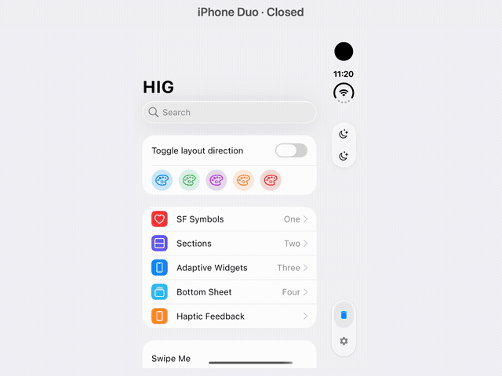
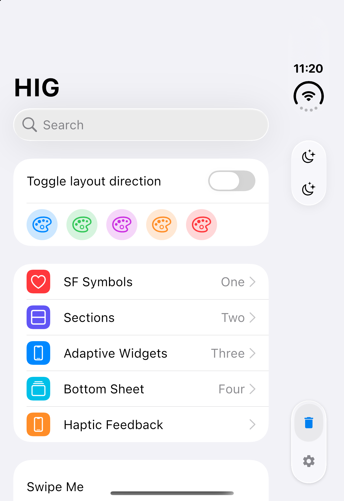
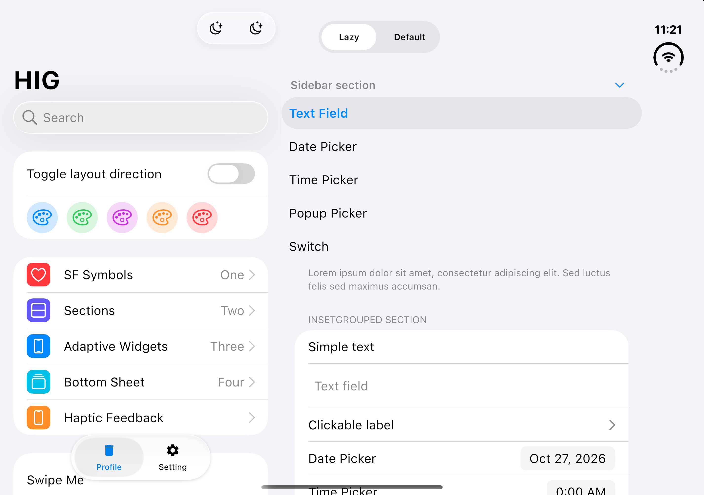
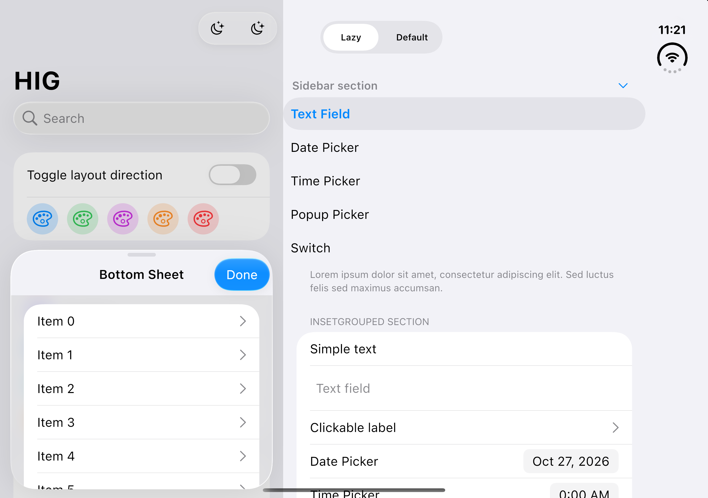

<!-- Replace the image path below with your project logo. -->
<p align="center">
  
</p>

# Compose-HIG

Apple HIG-inspired components, Liquid Glass effects, and optional UIKit integration for Compose Multiplatform.

[](https://central.sonatype.com/artifact/zone.ien.hig/hig)
[](https://github.com/ienground/compose-hig/actions/workflows/gradle.yml)
[](LICENSE.txt)

**English** | [한국어](README_ko.md)

<a id="overview"></a>

## Overview

Compose-HIG brings [Apple’s Human Interface Guidelines](https://developer.apple.com/design/human-interface-guidelines/) to shared [Compose Multiplatform](https://www.jetbrains.com/compose-multiplatform/) UI. Use Cupertino components directly for a consistent design across targets, opt into UIKit-backed controls on iOS, or choose adaptive components that switch between Cupertino and Material 3.

The project extends [alexzhirkevich/compose-cupertino](https://github.com/alexzhirkevich/compose-cupertino) and [slanos/compose-cupertino](https://github.com/slanos/compose-cupertino) with backdrop-based Liquid Glass rendering, additional controls, and adaptive navigation. Most UI is rendered by Compose; native iOS controls are provided separately in `hig-native`.

This README describes the current project APIs. Installation examples use version placeholders. See [installation](#installation) and [compatibility](#compatibility).

<a id="contents"></a>

## Table of Contents

- [Overview](#overview)
- [Table of Contents](#contents)
- [Preview](#preview)
  - [iPhone Duo](#duo-preview)
- [Features](#features)
- [Platform Support](#platforms)
- [Installation](#installation)
- [Quick Start](#quick-start)
- [Usage Examples](#examples)
  - [Liquid Glass Backgrounds](#glass)
  - [Segmented Controls](#segments)
  - [Swipe Actions](#swipe)
  - [Grouped Lists](#sections)
  - [Adaptive Components](#adaptive)
  - [iPhone Duo Layouts](#duo)
  - [Native iOS Dialogs](#native)
- [API Reference](#api)
  - [Component Families](#component-api)
  - [Theme and State](#theme-api)
  - [Liquid Button Parameters](#glass-api)
- [Compatibility & Limitations](#compatibility)
  - [iOS Native UI Flickering](#flickering)
- [Development](#development)
- [License & Attribution](#license)

<a id="preview"></a>

## Preview

Explore the **[interactive WasmJS showcase](https://hig.ien.zone)**, built from the [sample application](example/composeApp/).

[](docs/assets/compose-hig-ios-demo.mp4)

[Watch or download the MP4 demo](docs/assets/compose-hig-ios-demo.mp4). Recorded from this source build on the iPhone 18 Pro simulator running iOS 27.0, showing swipe actions, section navigation, Lazy/Default segmented selection, scrolling, and a switch.

<details>
<summary>Earlier demonstration video</summary>

https://github.com/user-attachments/assets/4cc67248-f666-4ba1-9f32-988356b96b2f

</details>

The deployed web demo and earlier video may differ from the current checkout.

<a id="duo-preview"></a>

### iPhone Duo

[](docs/assets/compose-hig-duo-demo.mp4)

[Watch or download the iPhone Duo MP4](docs/assets/compose-hig-duo-demo.mp4). Recorded from this source build on iOS 27.1 iPhone Duo simulators. The video joins separate recordings of the closed and open configurations with a cut. The open configuration combines Compose-HIG with Compose Adaptive (Compose Multiplatform Material 3 Adaptive) and Navigation 3 for list-detail navigation, and also shows a modal bottom sheet.

| Closed: right-side controls | Open: list and detail |
|-----------------------------|-----------------------|
| [](docs/assets/compose-hig-duo-closed.png) | [](docs/assets/compose-hig-duo-open.png) |

<details>
<summary>Modal bottom sheet on iPhone Duo</summary>

[](docs/assets/compose-hig-duo-sheet.png)

</details>

See [iPhone Duo layouts](#duo) for integration details and platform requirements.

<a id="features"></a>

## Features

- **Liquid Glass surfaces** — Buttons, icon buttons, dialogs, segmented controls, and navigation surfaces use backdrop rendering with blur, refraction, highlights, shadows, and background-aware colors. [Connect a background layer](#glass) to render content through the glass.
- **Interactive controls** — Segmented selection supports dragging and spring animation; swipe rows expose actions on either side and can invoke a full-swipe action. See [segmented controls](#segments) and [swipe actions](#swipe).
- **Grouped and collapsible lists** — `CupertinoSection`, `section`, and `stickySection` support grouped, inset, plain, and sidebar layouts with shared styling and section state.
- **iPhone Duo layouts** — Hinge-aware system-area handling positions controls on the right when the vertical bar layout is active. Adaptive list-detail helpers scope that handling to the pane at the physical right edge. See [screenshots and video](#duo-preview) and [integration details](#duo).
- **Screen structure and navigation** — Scaffolds, top and bottom app bars, navigation bars, modal and persistent bottom sheets, and four floating action button sizes provide screen-level building blocks.
- **Inputs, selection, and pickers** — Text, bordered and search fields, switches, checkboxes, sliders and range sliders, activity indicators, and wheel/date/time/date-time pickers cover common interaction patterns.
- **Optional native iOS controls** — `hig-native` adds UIKit-backed dialogs, action sheets, menus, date/time pickers, and navigation bars, with Compose fallbacks for the common native APIs on other targets.
- **Adaptive design systems** — `hig-adaptive` selects Cupertino on iOS and Material 3 elsewhere by default, allows per-component customization, and provides Navigation 3 list-detail helpers. [Choose or override the theme](#adaptive).
- **Shared theme and platform hooks** — Color schemes, typography, continuous shapes, iOS haptics, and accessibility preferences are exposed through `hig-core`; platform behavior is described [below](#platforms).
- **Cupertino vector icons** — `CupertinoIcons.Outlined` and `CupertinoIcons.Filled` provide Compose `ImageVector` icons; `Default` aliases `Outlined`. The optional extended module expands the available set.

<a id="platforms"></a>

## Platform Support

The [shared target convention](buildSrc/src/main/kotlin/multiplatform-module-convention.gradle.kts) configures the following library targets. “Configured” describes source/build support, not a guarantee that every effect or device has been tested.

| Platform | Status / targets | Native API behavior | Default adaptive theme |
|----------|------------------|---------------------|------------------------|
| Android | Configured: Android library, minimum API 29 | Compose fallbacks | Material 3 |
| iOS | Configured: `iosArm64`, `iosSimulatorArm64` | UIKit implementations | Cupertino |
| Desktop JVM | Configured: `desktop` | Compose fallbacks | Material 3 |
| macOS Native | Experimental Compose target: `macosArm64` | Compose fallbacks; not UIKit | Material 3 |
| Web JavaScript | Configured: `js(IR)` browser | Compose fallbacks | Material 3 |
| WebAssembly | Configured: `wasmJs` browser; sample and web demo available | Compose fallbacks | Material 3 |

No Intel Apple (`iosX64`, `macosX64`), tvOS, or watchOS targets are declared. The sample app targets Android, iOS, Desktop JVM, and WasmJS; it does not provide a separate JS or macOS Native launcher.

On iOS, haptics use UIKit generators. Other targets delegate to Compose’s `LocalHapticFeedback`, so device support determines the result. Reduced-transparency preferences are read on iOS and return `false` in the non-iOS implementation. High-contrast observation has platform-specific implementations; it is not a uniform system integration on every target.

<a id="installation"></a>

## Installation

Add repositories in `settings.gradle.kts`:

```kotlin
dependencyResolutionManagement {
    repositories {
        google()
        mavenCentral()
    }
}
```

Replace `{current version}` with the version you want to use, then add the core UI dependency to `commonMain`:

```kotlin
val hig = "{current version}"

kotlin {
    sourceSets {
        commonMain.dependencies {
            implementation("zone.ien.hig:hig:${hig}")
        }
    }
}
```

Alternatively, use a [Gradle version catalog](https://docs.gradle.org/current/userguide/version_catalogs.html). Choose only the modules you need:

```toml
[versions]
hig = "{current version}"

[libraries]
hig = { module = "zone.ien.hig:hig", version.ref = "hig" }
hig-adaptive = { module = "zone.ien.hig:hig-adaptive", version.ref = "hig" }
hig-native = { module = "zone.ien.hig:hig-native", version.ref = "hig" }
hig-icons-extended = { module = "zone.ien.hig:hig-icons-extended", version.ref = "hig" }
```

```kotlin
kotlin {
    sourceSets {
        commonMain.dependencies {
            implementation(libs.hig)
        }
    }
}
```

| Artifact | Purpose |
|----------|---------|
| [`zone.ien.hig:hig`](https://central.sonatype.com/artifact/zone.ien.hig/hig) | Compose Cupertino UI; includes `hig-core` transitively |
| [`zone.ien.hig:hig-core`](https://central.sonatype.com/artifact/zone.ien.hig/hig-core) | Theme foundations, colors, shapes, accessibility, and haptics |
| [`zone.ien.hig:hig-native`](https://central.sonatype.com/artifact/zone.ien.hig/hig-native) | Native iOS wrappers and non-iOS fallbacks; includes `hig` |
| [`zone.ien.hig:hig-adaptive`](https://central.sonatype.com/artifact/zone.ien.hig/hig-adaptive) | Cupertino/Material 3 adaptation; includes `hig` and `hig-native` |
| [`zone.ien.hig:hig-icons-extended`](https://central.sonatype.com/artifact/zone.ien.hig/hig-icons-extended) | Additional Cupertino vectors |

For local development, use project dependencies as the [sample does](example/composeApp/build.gradle.kts), or follow the [Maven Local instructions](#development).

<a id="quick-start"></a>

## Quick Start

Wrap your UI in `CupertinoTheme`, opt into experimental Cupertino APIs, and keep mutable values in caller-owned state. This complete composable renders a themed screen with a switch:

```kotlin
import androidx.compose.foundation.layout.Arrangement
import androidx.compose.foundation.layout.Column
import androidx.compose.foundation.layout.fillMaxSize
import androidx.compose.foundation.layout.padding
import androidx.compose.runtime.Composable
import androidx.compose.runtime.getValue
import androidx.compose.runtime.mutableStateOf
import androidx.compose.runtime.saveable.rememberSaveable
import androidx.compose.runtime.setValue
import androidx.compose.ui.Modifier
import androidx.compose.ui.unit.dp
import zone.ien.hig.CupertinoScaffold
import zone.ien.hig.CupertinoSwitch
import zone.ien.hig.CupertinoText
import zone.ien.hig.ExperimentalCupertinoApi
import zone.ien.hig.theme.CupertinoTheme

@OptIn(ExperimentalCupertinoApi::class)
@Composable
fun SettingsScreen() {
    CupertinoTheme {
        var notificationsEnabled by rememberSaveable { mutableStateOf(true) }

        CupertinoScaffold { contentPadding ->
            Column(
                modifier = Modifier.fillMaxSize().padding(contentPadding).padding(16.dp),
                verticalArrangement = Arrangement.spacedBy(12.dp),
            ) {
                CupertinoText("Notifications")
                CupertinoSwitch(
                    checked = notificationsEnabled,
                    onCheckedChange = { notificationsEnabled = it },
                )
            }
        }
    }
}
```

Call `SettingsScreen()` from your platform’s Compose host. Apply the scaffold’s `PaddingValues` to avoid overlapping its bars and insets. Explore the [Cupertino showcase](example/composeApp/src/commonMain/kotlin/cupertino/CupertinoWidgetsScreen.kt) for a complete integration.

<a id="examples"></a>

## Usage Examples

The following composables assume an enclosing `CupertinoTheme` unless they create an `AdaptiveTheme`. Examples use the current project APIs.

<a id="glass"></a>

### Liquid Glass Backgrounds

A backdrop must record the content behind the glass. Attach `Modifier.layerBackdrop` to the background sibling, then pass the same backdrop to the button. Keep the glass control outside the recorded layer.

```kotlin
import androidx.compose.foundation.background
import androidx.compose.foundation.layout.Box
import androidx.compose.foundation.layout.fillMaxSize
import androidx.compose.foundation.layout.padding
import androidx.compose.runtime.Composable
import androidx.compose.ui.Alignment
import androidx.compose.ui.Modifier
import androidx.compose.ui.graphics.Brush
import androidx.compose.ui.graphics.Color
import androidx.compose.ui.unit.dp
import com.kyant.backdrop.backdrops.layerBackdrop
import zone.ien.hig.CupertinoLiquidButton
import zone.ien.hig.CupertinoText
import zone.ien.hig.ExperimentalCupertinoApi
import zone.ien.hig.utils.rememberDefaultBackdrop

@OptIn(ExperimentalCupertinoApi::class)
@Composable
fun GlassButton(onClick: () -> Unit) {
    val backdrop = rememberDefaultBackdrop()
    Box(Modifier.fillMaxSize()) {
        Box(
            Modifier.fillMaxSize()
                .layerBackdrop(backdrop)
                .background(Brush.linearGradient(listOf(Color.Blue, Color.Magenta))),
        )
        CupertinoLiquidButton(
            onClick = onClick,
            backdrop = backdrop,
            modifier = Modifier.align(Alignment.Center).padding(16.dp),
        ) {
            CupertinoText("Continue")
        }
    }
}
```

`rememberDefaultBackdrop()` creates a `LayerBackdrop` initialized with the theme background; creating it alone does not capture surrounding content. `isBackgroundAdaptive` and `isInteractive` default to `true`. See the [button parameters](#glass-api) and [Backdrop implementation](hig/src/commonMain/kotlin/zone/ien/hig/utils/Backdrop.kt).

<a id="segments"></a>

### Segmented Controls

```kotlin
import androidx.compose.runtime.Composable
import androidx.compose.runtime.getValue
import androidx.compose.runtime.mutableStateOf
import androidx.compose.runtime.saveable.rememberSaveable
import androidx.compose.runtime.setValue
import zone.ien.hig.CupertinoSegmentedControl
import zone.ien.hig.CupertinoSegmentedControlTab
import zone.ien.hig.CupertinoText
import zone.ien.hig.ExperimentalCupertinoApi

@OptIn(ExperimentalCupertinoApi::class)
@Composable
fun FilterControl() {
    var selectedIndex by rememberSaveable { mutableStateOf(0) }
    CupertinoSegmentedControl(selectedTabIndex = selectedIndex) {
        listOf("All", "Favorites").forEachIndexed { index, label ->
            CupertinoSegmentedControlTab(
                isSelected = selectedIndex == index,
                onClick = { selectedIndex = index },
            ) {
                CupertinoText(label)
            }
        }
    }
}
```

Keep `selectedTabIndex` and each tab’s `isSelected` synchronized. Selection callbacks are supplied on the tabs; there is no parent `onSelectedTabChange` parameter. An external `LayerBackdrop` can be passed to the control when it should sample surrounding content.

<a id="swipe"></a>

### Swipe Actions

```kotlin
import androidx.compose.foundation.layout.padding
import androidx.compose.runtime.Composable
import androidx.compose.ui.Modifier
import androidx.compose.ui.unit.dp
import zone.ien.hig.CupertinoSwipeBox
import zone.ien.hig.CupertinoText
import zone.ien.hig.ExperimentalCupertinoApi
import zone.ien.hig.swipebox.CupertinoSwipeBoxItem
import zone.ien.hig.theme.CupertinoColors
import zone.ien.hig.theme.systemRed

@OptIn(ExperimentalCupertinoApi::class)
@Composable
fun DeletableRow(onDelete: () -> Unit) {
    CupertinoSwipeBox(
        actionItemBuilder = {
            end(onClick = onDelete) {
                CupertinoSwipeBoxItem(
                    color = CupertinoColors.systemRed,
                    label = "Delete",
                    onClick = onDelete,
                )
            }
        },
    ) {
        CupertinoText("Swipe to delete", modifier = Modifier.padding(16.dp))
    }
}
```

The builder’s `end(onClick = ...)` callback handles full-swipe invocation; the item’s `onClick` handles tapping the action. Supply both when both gestures should perform the same operation. Use `start { ... }` for the other side, and disable either direction with `startToEndFullSwipeEnabled` or `endToStartFullSwipeEnabled`. Both default to `true`. `CupertinoSwipeBoxItem.restoreOnClick` defaults to `true`.

<a id="sections"></a>

### Grouped Lists

```kotlin
import androidx.compose.foundation.layout.padding
import androidx.compose.foundation.lazy.LazyColumn
import androidx.compose.runtime.Composable
import androidx.compose.ui.Modifier
import androidx.compose.ui.unit.dp
import zone.ien.hig.CupertinoText
import zone.ien.hig.ExperimentalCupertinoApi
import zone.ien.hig.section.section

@OptIn(ExperimentalCupertinoApi::class)
@Composable
fun AccountList() {
    LazyColumn {
        section(
            title = { CupertinoText("Account") },
            caption = { CupertinoText("Manage your account settings.") },
        ) {
            item { CupertinoText("Profile", Modifier.padding(16.dp)) }
            item { CupertinoText("Privacy", Modifier.padding(16.dp)) }
        }
    }
}
```

Use `stickySection` for sticky headers or `CupertinoSection` for non-lazy content. `ProvideSectionStyle` shares `Sidebar`, `InsetGrouped` (default), `Grouped`, `Inset`, or `Plain` styling. Pass `rememberSectionState()` for collapsible sidebar sections. The [section showcase](example/composeApp/src/commonMain/kotlin/sections/SectionsScreen.kt) demonstrates these variants.

<a id="adaptive"></a>

### Adaptive Components

Requires `hig-adaptive`. Use the non-deprecated theme-specification overload explicitly:

```kotlin
import androidx.compose.runtime.Composable
import zone.ien.hig.CupertinoText
import zone.ien.hig.adaptive.AdaptiveButton
import zone.ien.hig.adaptive.AdaptiveTheme
import zone.ien.hig.adaptive.CupertinoThemeSpec
import zone.ien.hig.adaptive.ExperimentalAdaptiveApi
import zone.ien.hig.adaptive.MaterialThemeSpec

@OptIn(ExperimentalAdaptiveApi::class)
@Composable
fun AdaptiveAction(onClick: () -> Unit) {
    AdaptiveTheme(
        material = MaterialThemeSpec.Default(),
        cupertino = CupertinoThemeSpec.Default(),
    ) {
        AdaptiveButton(onClick = onClick) {
            CupertinoText("Continue")
        }
    }
}
```

The default is Cupertino on iOS and Material 3 on other platforms. Set `target = Theme.Cupertino` or `Theme.Material3` to override it. `MaterialThemeSpec` and `CupertinoThemeSpec` configure colors, shapes, and typography. Widget `adaptation` blocks provide `cupertino { ... }` and `material { ... }` customization.

For Navigation 3, `rememberAdaptiveListDetailSceneStrategy<T>()` defaults to two panes from medium width, `BackNavigationBehavior.PopLatest`, and `shouldHandleSinglePaneLayout = true`. Use `AdaptiveListDetailPane(role)` to scope right-side system-area handling to the appropriate pane, `isAdaptiveListDetailExpanded` to inspect the target layout, and `adaptivePaneAnimation()` for 160 ms fades and 240 ms bounds animation. These helpers require `ExperimentalMaterial3AdaptiveApi`; roles, preferred widths, and placeholder content remain caller-provided entry metadata. See [implementation](hig-adaptive/src/commonMain/kotlin/zone/ien/hig/adaptive/AdaptiveListDetail.kt) and [sample navigation](example/composeApp/src/commonMain/kotlin/RootNavigationGraph.kt).

<a id="duo"></a>

### iPhone Duo Layouts

The sample combines Compose-HIG with [Compose Adaptive](hig-adaptive/build.gradle.kts) (`org.jetbrains.compose.material3.adaptive`) and Navigation 3. Compose Adaptive supplies window-size directives and the list-detail scene strategy; Compose-HIG adds Cupertino styling and pane-specific system-area handling.

`CupertinoScaffold` observes the iOS status region, camera occlusion, safe-area insets, and hinge state to choose bar placement. On Duo, this allows content and controls to share the available screen without placing actions over the reserved system area.

| Layout | Behavior |
|--------|----------|
| Closed Duo | The captured compact layout keeps content in one pane and arranges top-bar actions and navigation tabs vertically on the right. |
| Open Duo | The sample’s wider window displays the navigation list and selected detail together. `AdaptiveListDetailPane` assigns right-side bars and insets to the pane at the physical right edge. |
| Modal bottom sheet | `CupertinoBottomSheetContent` keeps its top bar horizontal at the top of the sheet, including on Duo. |

Use `CupertinoTopAppBar` and `CupertinoNavigationBar` within `CupertinoScaffold` to participate in this placement. The top-bar title stays at the top while navigation buttons and actions can move into the right-side control area. When vertical navigation is active, tabs use icons; holding a tab for 0.5 seconds expands the bar and labels, and a drag selects its final tab on release.

For list-detail screens, use `rememberAdaptiveListDetailSceneStrategy<T>()` with caller-provided entry roles and wrap each pane in `AdaptiveListDetailPane(role)`, as described under [adaptive components](#adaptive). Pane count follows the window-adaptive directive; hinge detection supplies bar-placement information. Keep the `PaddingValues` supplied by each scaffold on its content.

Hinge observation is guarded for **iOS 27.1 or later** and a build SDK exposing `UIHingeInteraction`; the observer treats partially and fully open hinges as open. The media above verifies the closed and open simulator configurations, not physical hardware or every intermediate hinge angle.

Implementation references: [iOS placement](hig/src/iosMain/kotlin/zone/ien/hig/CupertinoBarPlacement.ios.kt), [guarded UIKit bridge](hig/src/nativeInterop/cinterop/cupertinoBarPlacement.def), [pane ownership](hig-adaptive/src/commonMain/kotlin/zone/ien/hig/adaptive/AdaptiveListDetail.kt), and [sample navigation](example/composeApp/src/commonMain/kotlin/RootNavigationGraph.kt).

<a id="native"></a>

### Native iOS Dialogs

Requires `hig-native`. The caller controls whether the dialog is composed and clears that state on dismissal or action:

```kotlin
import androidx.compose.runtime.Composable
import zone.ien.hig.CupertinoAlertDialogNative
import zone.ien.hig.ExperimentalCupertinoApi
import zone.ien.hig.cancel
import zone.ien.hig.destructive

@OptIn(ExperimentalCupertinoApi::class)
@Composable
fun DeleteConfirmation(
    visible: Boolean,
    onDismiss: () -> Unit,
    onConfirm: () -> Unit,
) {
    if (visible) {
        CupertinoAlertDialogNative(
            onDismissRequest = onDismiss,
            title = "Delete item?",
            message = "This action cannot be undone.",
        ) {
            cancel(onClick = onDismiss, title = "Cancel")
            destructive(
                onClick = {
                    onConfirm()
                    onDismiss()
                },
                title = "Delete",
            )
        }
    }
}
```

On iOS this uses `UIAlertController`; on other targets it delegates to the Compose Cupertino dialog. `NativeAlertDialogActionsScope` provides `action`, `default`, `cancel`, and `destructive`; action `enabled` defaults to `true`. The common native APIs also include action sheets, menus, navigation bars, and date/time pickers. `CupertinoColorPickerNative` is iOS-only. See the [native source sets](hig-native/src/) and the [flickering workaround](#flickering).

<a id="api"></a>

## API Reference

Public component functions generally live in `zone.ien.hig`; themes in `zone.ien.hig.theme`, sections in `zone.ien.hig.section`, swipe items/state in `zone.ien.hig.swipebox`, and adaptive APIs in `zone.ien.hig.adaptive`. The following source links provide complete signatures and KDoc.

<a id="component-api"></a>

### Component Families

| API / source | Purpose |
|--------------|---------|
| [`CupertinoButton`, `CupertinoIconButton`](hig/src/commonMain/kotlin/zone/ien/hig/CupertinoButton.kt) | Standard buttons, sizes, colors, enabled state, and content slots. |
| [`CupertinoLiquidButton`, `CupertinoLiquidIconButton`](hig/src/commonMain/kotlin/zone/ien/hig/CupertinoLiquidButton.kt) | Backdrop-aware buttons; see [parameters](#glass-api). |
| [`CupertinoAlertDialog`, `CupertinoActionSheet`](hig/src/commonMain/kotlin/zone/ien/hig/CupertinoDialogs.kt) | Compose dialogs and action builders; [Liquid Glass variants](hig/src/commonMain/kotlin/zone/ien/hig/CupertinoLiquidDialogs.kt) are also available. |
| [`CupertinoDropdownMenu`](hig/src/commonMain/kotlin/zone/ien/hig/CupertinoDropdownMenu.kt) | Popup menus with actions, sections, and dividers. |
| [`CupertinoTextField`, `CupertinoBorderedTextField`](hig/src/commonMain/kotlin/zone/ien/hig/CupertinoTextField.kt) | Text input; [search fields](hig/src/commonMain/kotlin/zone/ien/hig/CupertinoSearchTextField.kt) add search-specific UI. |
| [`CupertinoCheckBox`, `CupertinoTriStateCheckBox`](hig/src/commonMain/kotlin/zone/ien/hig/CupertinoCheckbox.kt) | Two-state and tri-state selection; [switches](hig/src/commonMain/kotlin/zone/ien/hig/CupertinoSwitch.kt) provide toggles. |
| [`CupertinoSlider`, `CupertinoRangeSlider`](hig/src/commonMain/kotlin/zone/ien/hig/CupertinoSlider.kt) | Continuous value and range input. |
| [`CupertinoPicker`](hig/src/commonMain/kotlin/zone/ien/hig/CupertinoPicker.kt) | Wheel selection; dedicated [date](hig/src/commonMain/kotlin/zone/ien/hig/CupertinoDatePicker.kt), [time](hig/src/commonMain/kotlin/zone/ien/hig/CupertinoTimePicker.kt), and [date-time](hig/src/commonMain/kotlin/zone/ien/hig/CupertinoDateTimePicker.kt) APIs. |
| [`CupertinoSegmentedControl`, `CupertinoSegmentedControlTab`](hig/src/commonMain/kotlin/zone/ien/hig/CupertinoSegmentedControl.kt) | State-controlled selection, draggable indicator, and tab callbacks. |
| [`CupertinoSwipeBox`](hig/src/commonMain/kotlin/zone/ien/hig/CupertinoSwipeBox.kt) | Start/end actions, remembered swipe state, and optional full-swipe invocation. |
| [`section`, `stickySection`](hig/src/commonMain/kotlin/zone/ien/hig/section/LazyListSection.kt) | Lazy sections; [CupertinoSection](hig/src/commonMain/kotlin/zone/ien/hig/section/Section.kt) handles non-lazy content. |
| [`CupertinoScaffold`](hig/src/commonMain/kotlin/zone/ien/hig/CupertinoScaffold.kt) | Top/bottom bar, snackbar, FAB, inset, and content slots. |
| [`CupertinoTopAppBar`](hig/src/commonMain/kotlin/zone/ien/hig/CupertinoTopBars.kt) | Top app bars; also [navigation bars](hig/src/commonMain/kotlin/zone/ien/hig/CupertinoNavigationBar.kt) and [bottom app bars](hig/src/commonMain/kotlin/zone/ien/hig/CupertinoBottomAppBar.kt). |
| [`CupertinoBottomSheet`](hig/src/commonMain/kotlin/zone/ien/hig/CupertinoBottomSheet.kt) | Modal sheet; [CupertinoBottomSheetScaffold](hig/src/commonMain/kotlin/zone/ien/hig/CupertinoBottomSheetScaffold.kt) provides persistent sheet structure. |
| [`CupertinoSmallFloatingActionButton`, `CupertinoMediumFloatingActionButton`, `CupertinoLargeFloatingActionButton`, `CupertinoExtraLargeFloatingActionButton`](hig/src/commonMain/kotlin/zone/ien/hig/CupertinoFloatingActionButton.kt) | Four floating action button sizes. |
| [`CupertinoActivityIndicator`](hig/src/commonMain/kotlin/zone/ien/hig/CupertinoActivityIndicator.kt) | Activity/loading feedback. |
| [`CupertinoText`](hig/src/commonMain/kotlin/zone/ien/hig/Text.kt) | Theme-aware text; [CupertinoIcon](hig/src/commonMain/kotlin/zone/ien/hig/CupertinoIcon.kt) renders vectors or painters. |

<a id="theme-api"></a>

### Theme and State

- [`CupertinoTheme`](hig/src/commonMain/kotlin/zone/ien/hig/theme/CupertinoTheme.kt) takes `colorScheme` (system light/dark by default), `shapes = Shapes()`, `typography = Typography()`, and a required composable `content`. Read values through `CupertinoTheme.colorScheme`, `.shapes`, and `.typography`.
- [`ColorScheme`](hig-core/src/commonMain/kotlin/zone/ien/hig/theme/ColorScheme.kt), `lightColorScheme()`, `darkColorScheme()`, and [`CupertinoColors`](hig-core/src/commonMain/kotlin/zone/ien/hig/theme/CupertinoColors.kt) expose semantic and system colors. Several `CupertinoColors` values, including `systemRed`, are extension properties and need their imports.
- [`SectionState`](hig/src/commonMain/kotlin/zone/ien/hig/section/SectionState.kt) exposes `isCollapsed`, mutable `canCollapse`, and `toggle()`, `collapse()`, `expand()`. `rememberSectionState(initiallyCollapsed = false, canCollapse = true)` saves section state.
- [`rememberCupertinoSwipeBoxState`](hig/src/commonMain/kotlin/zone/ien/hig/swipebox/CupertinoSwipeBoxState.kt) creates the `AnchoredDraggableState<SwipeBoxStates>` accepted by `CupertinoSwipeBox`.
- [`CupertinoIcons`](hig/src/commonMain/kotlin/zone/ien/hig/icons/CupertinoIcons.kt) groups vectors into `Outlined` and `Filled`; import each icon extension from its corresponding package. See the [icon sample](example/composeApp/src/commonMain/kotlin/icons/IconsScreen.kt).
- [`LocalCupertinoRightSystemArea`](hig/src/commonMain/kotlin/zone/ien/hig/CupertinoBarPlacement.kt) is a `CompositionLocal<Boolean>` defaulting to `true`. It indicates whether the current pane owns the right-side system area; `AdaptiveListDetailPane` scopes it for list-detail layouts. See [Duo integration](#duo).
- [`Accessibility`](hig-core/src/commonMain/kotlin/zone/ien/hig/Accessibility.kt) exposes `isHighContrastEnabled` and `isReduceTransparencyEnabled`; [`rememberCupertinoHapticFeedback()`](hig-core/src/commonMain/kotlin/zone/ien/hig/CupertinoHapticFeedback.kt) returns Compose `HapticFeedback`.

<a id="glass-api"></a>

### Liquid Button Parameters

Key parameters of `CupertinoLiquidButton`; the [source](hig/src/commonMain/kotlin/zone/ien/hig/CupertinoLiquidButton.kt) includes the complete signature.

| Parameter | Type | Default | Behavior |
|-----------|------|---------|----------|
| `onClick` | `() -> Unit` | Required | Click callback |
| `backdrop` | `Backdrop` | Required | Background source for glass rendering |
| `modifier` | `Modifier` | `Modifier` | Layout and semantics modifiers |
| `enabled` | `Boolean` | `true` | Enables interaction |
| `size` | `CupertinoButtonSize` | `Regular` | `Small`, `Regular`, `Large`, or `ExtraLarge` |
| `colors` | `CupertinoLiquidButtonColors` | `glassButtonColors()` | Tint, surface, and content colors; `glassProminentButtonColors()` is another preset |
| `shape` | `Shape` | `size.shape(CupertinoTheme.shapes)` | Shape derived from size and theme |
| `contentPadding` | `PaddingValues` | `size.contentPadding` | Inner spacing |
| `interactionSource` | `MutableInteractionSource` | Remembered instance | Press/interaction tracking |
| `isBackgroundAdaptive` | `Boolean` | `true` | Background-aware appearance |
| `isInteractive` | `Boolean` | `true` | Interactive visual response |
| `content` | `@Composable RowScope.() -> Unit` | Required | Button content |

<a id="compatibility"></a>

## Compatibility & Limitations

These are the **current source build settings**, not a compatibility promise for every published version or downstream project.

| Setting | Repository value / requirement |
|---------|--------------------------------|
| Kotlin / Compose compiler plugin | `2.4.21` |
| Compose Multiplatform | `1.12.2` |
| Material 3 dependency | `1.12.0-alpha03` |
| Android Gradle Plugin | `9.3.1` |
| Gradle wrapper | `9.7.0` |
| Android SDK | Minimum `29`; compile `37` with minor API `1`; sample target `37` |
| JVM bytecode | Target `17` for Android and Desktop library code |
| Build JDK | Publishing workflow uses JDK `21`; test/deploy workflows currently declare JDK `17` |
| iOS sample deployment target | `15.3` in the Xcode project; not a verified minimum for all library dependencies |
| Apple builds | macOS and an appropriate Xcode/SDK installation |
| Browser tests | Chrome/Chromium for the configured Karma headless runner |

Sources: [version catalog](gradle/libs.versions.toml), [Gradle properties](gradle.properties), [target convention](buildSrc/src/main/kotlin/multiplatform-module-convention.gradle.kts), [wrapper](gradle/wrapper/gradle-wrapper.properties), and [workflows](.github/workflows/).

- iPhone Duo hinge observation requires iOS 27.1+ and the corresponding SDK APIs. The [Duo preview](#duo-preview) was captured in simulators; physical-device and intermediate-angle behavior were not tested for this documentation update.
- Many Cupertino APIs require `@OptIn(ExperimentalCupertinoApi::class)`; adaptive APIs require `ExperimentalAdaptiveApi`. Navigation helpers may require additional upstream experimental opt-ins. Alpha versions can change APIs.
- UIKit-backed components are native only on iOS. OS-controlled layout, appearance, and supported customization can differ from Compose fallbacks.
- Liquid Glass visuals depend on the rendering backend, OS, accessibility settings, and captured background. A configured target does not establish identical optical effects across platforms.
- `CupertinoTheme` installs accessibility observation and haptic/theme defaults, but does not turn Compose components into UIKit views. Reduced transparency changes glass rendering on iOS.
- The repository disables Gradle configuration caching because of the WasmJS target. Preserve copyright headers in contributions; focused tests live in the modules’ test source sets.

<a id="flickering"></a>

### iOS Native UI Flickering

If Compose content briefly disappears while presenting a native menu, alert, or action sheet, disable parallel rendering in the root `ComposeUIViewController`:

```kotlin
import androidx.compose.ui.ExperimentalComposeUiApi
import androidx.compose.ui.window.ComposeUIViewController

@OptIn(ExperimentalComposeUiApi::class)
fun MainViewController() = ComposeUIViewController(
    configure = {
        parallelRendering = false
    },
) {
    App()
}
```

Here `App()` is your application’s root composable. This workaround synchronizes rendering with UIKit presentation transitions, at the cost of disabling the dedicated parallel rendering path. Apply it when the flickering occurs; it is not required initialization for all integrations.

<a id="development"></a>

## Development

Run commands from the repository root with the included Gradle wrapper. The [sample build](example/composeApp/build.gradle.kts) uses local module dependencies, so it exercises this checkout rather than a published binary.

```shell
./gradlew :hig:tasks :hig-adaptive:tasks --all
./gradlew :hig:assemble :hig-core:assemble :hig-native:assemble :hig-adaptive:assemble :hig-icons-extended:assemble
./gradlew :hig:desktopTest :hig-adaptive:desktopTest
./gradlew :hig:jsBrowserTest :hig-adaptive:jsBrowserTest
```

Sample launch/build commands:

```shell
./gradlew :example:composeApp:run
./gradlew :example:composeApp:wasmJsBrowserDevelopmentRun
./gradlew :example:composeApp:wasmJsBrowserDistribution
./gradlew :example:androidApp:assembleDebug
```

For iOS, open [the Xcode project](example/iosApp/iosApp.xcodeproj/) on macOS and run the `iosApp` scheme on an ARM64 simulator or device. Android can be launched through the `example:androidApp` run configuration in Android Studio. Desktop packaging is configured for DMG, MSI, and DEB in the sample build.

To install source-version artifacts locally:

```shell
./gradlew :hig-core:publishToMavenLocal :hig:publishToMavenLocal :hig-native:publishToMavenLocal :hig-adaptive:publishToMavenLocal :hig-icons-extended:publishToMavenLocal
```

Full multiplatform assembly and local publication require the corresponding platform toolchains. Build and test commands above describe the available tasks; they are not a claim that all platforms were run during documentation maintenance. The [CI workflow](.github/workflows/gradle.yml) defines desktop, JS, iOS simulator, and macOS Native test jobs; [deployment](.github/workflows/deploy.yml) builds the WasmJS distribution.

Useful entry points: [application theme](example/composeApp/src/commonMain/kotlin/App.kt), [Cupertino controls](example/composeApp/src/commonMain/kotlin/cupertino/CupertinoWidgetsScreen.kt), [adaptive controls](example/composeApp/src/commonMain/kotlin/adaptive/AdaptiveWidgetsScreen.kt), [sections](example/composeApp/src/commonMain/kotlin/sections/SectionsScreen.kt), and [haptics](example/composeApp/src/commonMain/kotlin/haptic/HapticFeedbackScreen.kt).

<a id="license"></a>

## License & Attribution

Licensed under the [Apache License 2.0](LICENSE.txt). The license file also retains its JetBrains copyright notice.

Compose-HIG is a fork and extension of [alexzhirkevich/compose-cupertino](https://github.com/alexzhirkevich/compose-cupertino) and [slanos/compose-cupertino](https://github.com/slanos/compose-cupertino). This repository adds Liquid Glass controls, swipe actions, expanded component APIs, and adaptive navigation work. Rendering uses [Backdrop](https://github.com/Kyant0/AndroidLiquidGlass); dependency coordinates and versions are recorded in the [version catalog](gradle/libs.versions.toml).

Existing project copyright notices are retained:

```text
Copyright (c) 2023-2024. Compose Cupertino project and open source contributors.
Copyright (c) 2025. Scott Lanoue.
Copyright (c) 2026. IENGROUND of IENLAB.
```
