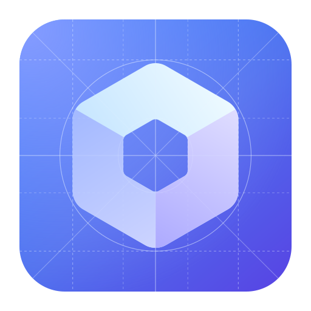
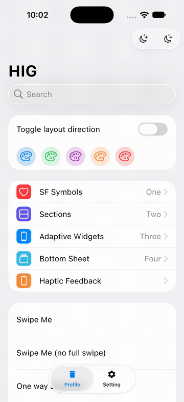

<!-- 아래 이미지 경로를 프로젝트 로고 경로로 교체하세요. -->
<p align="center">
  
</p>

# Compose-HIG

Compose Multiplatform에서 Apple HIG 스타일 컴포넌트, Liquid Glass 효과, 선택적 UIKit 연동을 제공하는 UI 라이브러리입니다.

[](https://central.sonatype.com/artifact/zone.ien.hig/hig)
[](https://github.com/ienground/compose-hig/actions/workflows/gradle.yml)
[](LICENSE.txt)

[English](README.md) | **한국어**

<a id="overview"></a>

## 개요

Compose-HIG는 [Apple Human Interface Guidelines](https://developer.apple.com/design/human-interface-guidelines/) 스타일을 공통 [Compose Multiplatform](https://www.jetbrains.com/compose-multiplatform/) UI에서 사용할 수 있게 합니다. 모든 대상에서 Cupertino 디자인을 직접 사용하거나, iOS에서 UIKit 기반 컨트롤을 선택하거나, Cupertino와 Material 3를 전환하는 적응형 컴포넌트를 사용할 수 있습니다.

[alexzhirkevich/compose-cupertino](https://github.com/alexzhirkevich/compose-cupertino)와 [slanos/compose-cupertino](https://github.com/slanos/compose-cupertino)를 바탕으로 배경 레이어 기반 Liquid Glass 렌더링, 추가 컨트롤, 적응형 내비게이션을 확장했습니다. 대부분의 UI는 Compose로 렌더링하며, iOS 네이티브 컨트롤은 `hig-native`에서 별도로 제공합니다.

이 문서와 설치 예제는 현재 프로젝트 버전인 **`27.2.0-alpha01`**을 기준으로 합니다. [설치](#installation)와 [호환성](#compatibility)을 참고하세요.

<a id="contents"></a>

## 목차

- [개요](#overview)
- [목차](#contents)
- [미리보기](#preview)
- [주요 기능](#features)
- [플랫폼 지원](#platforms)
- [설치](#installation)
- [빠른 시작](#quick-start)
- [사용 예제](#examples)
  - [Liquid Glass 배경](#glass)
  - [세그먼트 컨트롤](#segments)
  - [스와이프 액션](#swipe)
  - [그룹 목록](#sections)
  - [적응형 컴포넌트](#adaptive)
  - [iOS 네이티브 대화상자](#native)
- [API 레퍼런스](#api)
  - [컴포넌트 구성](#component-api)
  - [테마 및 상태](#theme-api)
  - [Liquid 버튼 매개변수](#glass-api)
- [호환성 및 제한 사항](#compatibility)
  - [iOS 네이티브 UI 깜빡임](#flickering)
- [개발](#development)
- [라이선스 및 출처](#license)

<a id="preview"></a>

## 미리보기

[샘플 앱](example/composeApp/)으로 제작한 **[WasmJS 인터랙티브 데모](https://hig.ien.zone)**를 확인하세요.

[](docs/assets/compose-hig-ios-demo.mp4)

[MP4 시연 영상 재생 및 다운로드](docs/assets/compose-hig-ios-demo.mp4). 현재 소스를 빌드해 iOS 27.0의 iPhone 18 Pro 시뮬레이터에서 촬영했습니다. 스와이프 액션, 섹션 화면 이동, Lazy/Default 세그먼트 선택, 스크롤, 스위치 조작을 보여줍니다.

<details>
<summary>이전 시연 영상</summary>

https://github.com/user-attachments/assets/4cc67248-f666-4ba1-9f32-988356b96b2f

</details>

배포된 웹 데모와 이전 영상은 현재 체크아웃의 구현과 다를 수 있습니다.

<a id="features"></a>

## 주요 기능

- **Liquid Glass 표면** — 버튼, 아이콘 버튼, 대화상자, 세그먼트 컨트롤, 내비게이션 표면에 배경 렌더링을 활용한 블러, 굴절, 하이라이트, 그림자, 배경에 맞춘 색상을 적용합니다. [배경 레이어를 연결](#glass)하면 유리 너머로 콘텐츠를 표시할 수 있습니다.
- **상호작용 컨트롤** — 세그먼트 선택은 드래그와 스프링 애니메이션을 지원하며, 스와이프 행은 양쪽 액션 표시와 전체 스와이프 액션 실행을 지원합니다. [세그먼트 컨트롤](#segments)과 [스와이프 액션](#swipe)을 참고하세요.
- **그룹 및 접기 가능한 목록** — `CupertinoSection`, `section`, `stickySection`으로 그룹, 인셋, 일반, 사이드바 레이아웃을 구성하고 스타일과 섹션 상태를 공유합니다.
- **화면 구조와 내비게이션** — Scaffold, 상단·하단 앱 바, 내비게이션 바, 모달·고정형 하단 시트, 네 가지 크기의 플로팅 액션 버튼으로 화면을 구성합니다.
- **입력·선택·피커** — 일반·테두리·검색 입력창, 스위치, 체크박스, 슬라이더와 범위 슬라이더, 활동 표시기, 휠·날짜·시간·날짜시간 피커로 일반적인 상호작용을 구현합니다.
- **선택적 iOS 네이티브 컨트롤** — `hig-native`는 UIKit 기반 대화상자, 액션 시트, 메뉴, 날짜·시간 피커, 내비게이션 바를 제공합니다. 다른 대상에서는 공통 네이티브 API에 Compose 대체 구현을 사용합니다.
- **적응형 디자인 시스템** — `hig-adaptive`는 기본적으로 iOS에서 Cupertino, 나머지 플랫폼에서 Material 3를 선택합니다. 컴포넌트별 설정과 Navigation 3 목록·상세 헬퍼도 제공합니다. [테마 선택 및 재정의](#adaptive)를 참고하세요.
- **공통 테마와 플랫폼 연동** — `hig-core`에서 색상 체계, 타이포그래피, 연속 곡선 도형, iOS 햅틱, 접근성 설정을 제공합니다. 플랫폼별 동작은 [지원 표](#platforms)에 설명되어 있습니다.
- **Cupertino 벡터 아이콘** — `CupertinoIcons.Outlined`와 `CupertinoIcons.Filled`는 Compose `ImageVector` 아이콘을 제공하며, `Default`는 `Outlined`의 별칭입니다. 선택적 확장 모듈로 더 많은 아이콘을 사용할 수 있습니다.

<a id="platforms"></a>

## 플랫폼 지원

[공통 타깃 설정](buildSrc/src/main/kotlin/multiplatform-module-convention.gradle.kts)에 선언된 라이브러리 대상을 정리했습니다. ‘설정됨’은 소스·빌드 대상이 존재한다는 의미이며, 모든 효과와 기기에서 검증했다는 뜻은 아닙니다.

| 플랫폼 | 상태 / 타깃 | 네이티브 API 동작 | 기본 적응형 테마 |
|--------|-------------|------------------|------------------|
| Android | 설정됨: Android 라이브러리, 최소 API 29 | Compose 대체 구현 | Material 3 |
| iOS | 설정됨: `iosArm64`, `iosSimulatorArm64` | UIKit 구현 | Cupertino |
| Desktop JVM | 설정됨: `desktop` | Compose 대체 구현 | Material 3 |
| macOS Native | 실험적 Compose 타깃: `macosArm64` | UIKit이 아닌 Compose 대체 구현 | Material 3 |
| Web JavaScript | 설정됨: `js(IR)` 브라우저 | Compose 대체 구현 | Material 3 |
| WebAssembly | 설정됨: `wasmJs` 브라우저, 샘플 및 웹 데모 제공 | Compose 대체 구현 | Material 3 |

Intel Apple 타깃(`iosX64`, `macosX64`), tvOS, watchOS는 선언되어 있지 않습니다. 샘플 앱은 Android, iOS, Desktop JVM, WasmJS를 대상으로 하며 JS와 macOS Native 전용 실행 진입점은 제공하지 않습니다.

iOS 햅틱은 UIKit 생성기를 사용합니다. 다른 대상은 Compose의 `LocalHapticFeedback`에 위임하므로 기기 지원에 따라 결과가 달라집니다. 투명도 줄이기 설정은 iOS에서 읽으며, 비iOS 구현은 `false`를 반환합니다. 고대비 관찰은 플랫폼별 구현을 사용하므로 모든 대상에서 동일한 시스템 연동을 제공하지는 않습니다.

<a id="installation"></a>

## 설치

`settings.gradle.kts`에 저장소를 설정하세요.

```kotlin
dependencyResolutionManagement {
    repositories {
        google()
        mavenCentral()
    }
}
```

기존 Compose Multiplatform 프로젝트의 `commonMain`에 기본 UI 의존성을 추가하세요.

```kotlin
kotlin {
    sourceSets {
        commonMain.dependencies {
            implementation("zone.ien.hig:hig:27.2.0-alpha01")
        }
    }
}
```

또는 [Gradle Version Catalog](https://docs.gradle.org/current/userguide/version_catalogs.html)를 사용하세요. 필요한 모듈만 선택하면 됩니다.

```toml
[versions]
hig = "27.2.0-alpha01"

[libraries]
hig = { module = "zone.ien.hig:hig", version.ref = "hig" }
hig-adaptive = { module = "zone.ien.hig:hig-adaptive", version.ref = "hig" }
hig-native = { module = "zone.ien.hig:hig-native", version.ref = "hig" }
hig-icons-extended = { module = "zone.ien.hig:hig-icons-extended", version.ref = "hig" }
```

```kotlin
kotlin {
    sourceSets {
        commonMain.dependencies {
            implementation(libs.hig)
        }
    }
}
```

| 아티팩트 | 용도 |
|----------|------|
| [`zone.ien.hig:hig`](https://central.sonatype.com/artifact/zone.ien.hig/hig) | Compose Cupertino UI, `hig-core`를 전이 의존성으로 포함 |
| [`zone.ien.hig:hig-core`](https://central.sonatype.com/artifact/zone.ien.hig/hig-core) | 테마 기반, 색상, 도형, 접근성, 햅틱 |
| [`zone.ien.hig:hig-native`](https://central.sonatype.com/artifact/zone.ien.hig/hig-native) | iOS 네이티브 래퍼와 비iOS 대체 구현, `hig` 포함 |
| [`zone.ien.hig:hig-adaptive`](https://central.sonatype.com/artifact/zone.ien.hig/hig-adaptive) | Cupertino/Material 3 전환, `hig`와 `hig-native` 포함 |
| [`zone.ien.hig:hig-icons-extended`](https://central.sonatype.com/artifact/zone.ien.hig/hig-icons-extended) | 추가 Cupertino 벡터 아이콘 |

로컬 개발에서는 [샘플처럼](example/composeApp/build.gradle.kts) 프로젝트 의존성을 사용하거나 [Maven Local 안내](#development)를 참고하세요.

<a id="quick-start"></a>

## 빠른 시작

UI를 `CupertinoTheme`으로 감싸고 실험적 Cupertino API 사용을 선언하세요. 변경 가능한 값은 호출자가 관리합니다. 다음 컴포저블은 스위치가 있는 테마 화면을 구성합니다.

```kotlin
import androidx.compose.foundation.layout.Arrangement
import androidx.compose.foundation.layout.Column
import androidx.compose.foundation.layout.fillMaxSize
import androidx.compose.foundation.layout.padding
import androidx.compose.runtime.Composable
import androidx.compose.runtime.getValue
import androidx.compose.runtime.mutableStateOf
import androidx.compose.runtime.saveable.rememberSaveable
import androidx.compose.runtime.setValue
import androidx.compose.ui.Modifier
import androidx.compose.ui.unit.dp
import zone.ien.hig.CupertinoScaffold
import zone.ien.hig.CupertinoSwitch
import zone.ien.hig.CupertinoText
import zone.ien.hig.ExperimentalCupertinoApi
import zone.ien.hig.theme.CupertinoTheme

@OptIn(ExperimentalCupertinoApi::class)
@Composable
fun SettingsScreen() {
    CupertinoTheme {
        var notificationsEnabled by rememberSaveable { mutableStateOf(true) }

        CupertinoScaffold { contentPadding ->
            Column(
                modifier = Modifier.fillMaxSize().padding(contentPadding).padding(16.dp),
                verticalArrangement = Arrangement.spacedBy(12.dp),
            ) {
                CupertinoText("Notifications")
                CupertinoSwitch(
                    checked = notificationsEnabled,
                    onCheckedChange = { notificationsEnabled = it },
                )
            }
        }
    }
}
```

플랫폼별 Compose 호스트에서 `SettingsScreen()`을 호출하세요. Scaffold가 전달한 `PaddingValues`를 적용하면 바 및 인셋 영역과 콘텐츠가 겹치는 것을 피할 수 있습니다. 전체 통합 예제는 [Cupertino 쇼케이스](example/composeApp/src/commonMain/kotlin/cupertino/CupertinoWidgetsScreen.kt)를 참고하세요.

<a id="examples"></a>

## 사용 예제

다음 컴포저블은 `AdaptiveTheme`을 직접 구성하는 경우를 제외하면 상위에 `CupertinoTheme`이 있다고 가정합니다. 예제는 현재 프로젝트 API를 사용합니다.

<a id="glass"></a>

### Liquid Glass 배경

Backdrop에는 유리 뒤의 콘텐츠를 기록해야 합니다. 배경 형제 요소에 `Modifier.layerBackdrop`을 적용하고 같은 backdrop을 버튼에 전달하세요. 유리 컨트롤은 기록 대상 레이어 밖에 배치합니다.

```kotlin
import androidx.compose.foundation.background
import androidx.compose.foundation.layout.Box
import androidx.compose.foundation.layout.fillMaxSize
import androidx.compose.foundation.layout.padding
import androidx.compose.runtime.Composable
import androidx.compose.ui.Alignment
import androidx.compose.ui.Modifier
import androidx.compose.ui.graphics.Brush
import androidx.compose.ui.graphics.Color
import androidx.compose.ui.unit.dp
import com.kyant.backdrop.backdrops.layerBackdrop
import zone.ien.hig.CupertinoLiquidButton
import zone.ien.hig.CupertinoText
import zone.ien.hig.ExperimentalCupertinoApi
import zone.ien.hig.utils.rememberDefaultBackdrop

@OptIn(ExperimentalCupertinoApi::class)
@Composable
fun GlassButton(onClick: () -> Unit) {
    val backdrop = rememberDefaultBackdrop()
    Box(Modifier.fillMaxSize()) {
        Box(
            Modifier.fillMaxSize()
                .layerBackdrop(backdrop)
                .background(Brush.linearGradient(listOf(Color.Blue, Color.Magenta))),
        )
        CupertinoLiquidButton(
            onClick = onClick,
            backdrop = backdrop,
            modifier = Modifier.align(Alignment.Center).padding(16.dp),
        ) {
            CupertinoText("Continue")
        }
    }
}
```

`rememberDefaultBackdrop()`은 테마 배경으로 초기화한 `LayerBackdrop`을 생성합니다. 생성만으로 주변 콘텐츠가 캡처되지는 않습니다. `isBackgroundAdaptive`와 `isInteractive`의 기본값은 `true`입니다. [버튼 매개변수](#glass-api)와 [Backdrop 구현](hig/src/commonMain/kotlin/zone/ien/hig/utils/Backdrop.kt)을 참고하세요.

<a id="segments"></a>

### 세그먼트 컨트롤

```kotlin
import androidx.compose.runtime.Composable
import androidx.compose.runtime.getValue
import androidx.compose.runtime.mutableStateOf
import androidx.compose.runtime.saveable.rememberSaveable
import androidx.compose.runtime.setValue
import zone.ien.hig.CupertinoSegmentedControl
import zone.ien.hig.CupertinoSegmentedControlTab
import zone.ien.hig.CupertinoText
import zone.ien.hig.ExperimentalCupertinoApi

@OptIn(ExperimentalCupertinoApi::class)
@Composable
fun FilterControl() {
    var selectedIndex by rememberSaveable { mutableStateOf(0) }
    CupertinoSegmentedControl(selectedTabIndex = selectedIndex) {
        listOf("All", "Favorites").forEachIndexed { index, label ->
            CupertinoSegmentedControlTab(
                isSelected = selectedIndex == index,
                onClick = { selectedIndex = index },
            ) {
                CupertinoText(label)
            }
        }
    }
}
```

`selectedTabIndex`와 각 탭의 `isSelected`를 일치시켜야 합니다. 선택 콜백은 각 탭에 전달하며, 부모 컨트롤에는 `onSelectedTabChange` 매개변수가 없습니다. 주변 콘텐츠를 배경으로 사용하려면 외부 `LayerBackdrop`을 전달할 수 있습니다.

<a id="swipe"></a>

### 스와이프 액션

```kotlin
import androidx.compose.foundation.layout.padding
import androidx.compose.runtime.Composable
import androidx.compose.ui.Modifier
import androidx.compose.ui.unit.dp
import zone.ien.hig.CupertinoSwipeBox
import zone.ien.hig.CupertinoText
import zone.ien.hig.ExperimentalCupertinoApi
import zone.ien.hig.swipebox.CupertinoSwipeBoxItem
import zone.ien.hig.theme.CupertinoColors
import zone.ien.hig.theme.systemRed

@OptIn(ExperimentalCupertinoApi::class)
@Composable
fun DeletableRow(onDelete: () -> Unit) {
    CupertinoSwipeBox(
        actionItemBuilder = {
            end(onClick = onDelete) {
                CupertinoSwipeBoxItem(
                    color = CupertinoColors.systemRed,
                    label = "Delete",
                    onClick = onDelete,
                )
            }
        },
    ) {
        CupertinoText("Swipe to delete", modifier = Modifier.padding(16.dp))
    }
}
```

빌더의 `end(onClick = ...)` 콜백은 전체 스와이프 실행을, 아이템의 `onClick`은 액션 탭을 처리합니다. 두 제스처로 같은 작업을 실행하려면 콜백을 모두 전달하세요. 반대쪽에는 `start { ... }`를 사용합니다. `startToEndFullSwipeEnabled` 또는 `endToStartFullSwipeEnabled`로 방향별 전체 스와이프를 끌 수 있으며 둘 다 기본값은 `true`입니다. `CupertinoSwipeBoxItem.restoreOnClick`의 기본값도 `true`입니다.

<a id="sections"></a>

### 그룹 목록

```kotlin
import androidx.compose.foundation.layout.padding
import androidx.compose.foundation.lazy.LazyColumn
import androidx.compose.runtime.Composable
import androidx.compose.ui.Modifier
import androidx.compose.ui.unit.dp
import zone.ien.hig.CupertinoText
import zone.ien.hig.ExperimentalCupertinoApi
import zone.ien.hig.section.section

@OptIn(ExperimentalCupertinoApi::class)
@Composable
fun AccountList() {
    LazyColumn {
        section(
            title = { CupertinoText("Account") },
            caption = { CupertinoText("Manage your account settings.") },
        ) {
            item { CupertinoText("Profile", Modifier.padding(16.dp)) }
            item { CupertinoText("Privacy", Modifier.padding(16.dp)) }
        }
    }
}
```

고정 헤더는 `stickySection`, 지연 로딩이 필요 없는 콘텐츠는 `CupertinoSection`을 사용하세요. `ProvideSectionStyle`로 `Sidebar`, `InsetGrouped`(기본값), `Grouped`, `Inset`, `Plain` 스타일을 공유할 수 있습니다. 접기 가능한 사이드바 섹션에는 `rememberSectionState()`를 전달하세요. [섹션 쇼케이스](example/composeApp/src/commonMain/kotlin/sections/SectionsScreen.kt)에서 각 변형을 확인할 수 있습니다.

<a id="adaptive"></a>

### 적응형 컴포넌트

`hig-adaptive`가 필요합니다. 사용 중단되지 않은 테마 명세 오버로드를 명시적으로 사용하세요.

```kotlin
import androidx.compose.runtime.Composable
import zone.ien.hig.CupertinoText
import zone.ien.hig.adaptive.AdaptiveButton
import zone.ien.hig.adaptive.AdaptiveTheme
import zone.ien.hig.adaptive.CupertinoThemeSpec
import zone.ien.hig.adaptive.ExperimentalAdaptiveApi
import zone.ien.hig.adaptive.MaterialThemeSpec

@OptIn(ExperimentalAdaptiveApi::class)
@Composable
fun AdaptiveAction(onClick: () -> Unit) {
    AdaptiveTheme(
        material = MaterialThemeSpec.Default(),
        cupertino = CupertinoThemeSpec.Default(),
    ) {
        AdaptiveButton(onClick = onClick) {
            CupertinoText("Continue")
        }
    }
}
```

기본 테마는 iOS에서 Cupertino, 나머지 플랫폼에서 Material 3입니다. `target = Theme.Cupertino` 또는 `Theme.Material3`로 재정의할 수 있습니다. `MaterialThemeSpec`과 `CupertinoThemeSpec`으로 색상, 도형, 타이포그래피를 설정하고, 위젯의 `adaptation` 블록 안에서 `cupertino { ... }`와 `material { ... }`로 각각 조정합니다.

Navigation 3용 `rememberAdaptiveListDetailSceneStrategy<T>()`는 기본적으로 중간 너비부터 두 패널을 사용하며, `BackNavigationBehavior.PopLatest`와 `shouldHandleSinglePaneLayout = true`를 적용합니다. `AdaptiveListDetailPane(role)`로 오른쪽 시스템 영역 처리를 해당 패널에 한정하고, `isAdaptiveListDetailExpanded`로 목표 레이아웃을 확인하며, `adaptivePaneAnimation()`으로 160ms 페이드와 240ms 위치·크기 애니메이션을 적용합니다. 이 헬퍼에는 `ExperimentalMaterial3AdaptiveApi` 사용 선언이 필요합니다. 역할, 선호 너비, 미선택 안내 콘텐츠는 호출자가 entry 메타데이터로 제공해야 합니다. [구현](hig-adaptive/src/commonMain/kotlin/zone/ien/hig/adaptive/AdaptiveListDetail.kt)과 [샘플 내비게이션](example/composeApp/src/commonMain/kotlin/RootNavigationGraph.kt)을 참고하세요.

<a id="native"></a>

### iOS 네이티브 대화상자

`hig-native`가 필요합니다. 호출자가 대화상자의 표시 여부를 관리하고 닫기 요청이나 액션 실행 시 상태를 해제합니다.

```kotlin
import androidx.compose.runtime.Composable
import zone.ien.hig.CupertinoAlertDialogNative
import zone.ien.hig.ExperimentalCupertinoApi
import zone.ien.hig.cancel
import zone.ien.hig.destructive

@OptIn(ExperimentalCupertinoApi::class)
@Composable
fun DeleteConfirmation(
    visible: Boolean,
    onDismiss: () -> Unit,
    onConfirm: () -> Unit,
) {
    if (visible) {
        CupertinoAlertDialogNative(
            onDismissRequest = onDismiss,
            title = "Delete item?",
            message = "This action cannot be undone.",
        ) {
            cancel(onClick = onDismiss, title = "Cancel")
            destructive(
                onClick = {
                    onConfirm()
                    onDismiss()
                },
                title = "Delete",
            )
        }
    }
}
```

iOS에서는 `UIAlertController`를 사용하며, 다른 대상에서는 Compose Cupertino 대화상자에 위임합니다. `NativeAlertDialogActionsScope`는 `action`, `default`, `cancel`, `destructive`를 제공하고 액션의 `enabled` 기본값은 `true`입니다. 공통 네이티브 API에는 액션 시트, 메뉴, 내비게이션 바, 날짜·시간 피커도 포함됩니다. `CupertinoColorPickerNative`는 iOS 전용입니다. [네이티브 소스 세트](hig-native/src/)와 [깜빡임 대응 방법](#flickering)을 참고하세요.

<a id="api"></a>

## API 레퍼런스

공개 컴포넌트 함수는 주로 `zone.ien.hig`, 테마는 `zone.ien.hig.theme`, 섹션은 `zone.ien.hig.section`, 스와이프 아이템·상태는 `zone.ien.hig.swipebox`, 적응형 API는 `zone.ien.hig.adaptive`에 있습니다. 전체 시그니처와 KDoc은 아래 소스 링크에서 확인할 수 있습니다.

<a id="component-api"></a>

### 컴포넌트 구성

| API / 소스 | 용도 |
|------------|------|
| [`CupertinoButton`, `CupertinoIconButton`](hig/src/commonMain/kotlin/zone/ien/hig/CupertinoButton.kt) | 일반 버튼, 크기, 색상, 활성 상태, 콘텐츠 슬롯. |
| [`CupertinoLiquidButton`, `CupertinoLiquidIconButton`](hig/src/commonMain/kotlin/zone/ien/hig/CupertinoLiquidButton.kt) | 배경을 반영하는 버튼. [매개변수](#glass-api) 참고. |
| [`CupertinoAlertDialog`, `CupertinoActionSheet`](hig/src/commonMain/kotlin/zone/ien/hig/CupertinoDialogs.kt) | Compose 대화상자와 액션 빌더. [Liquid Glass 변형](hig/src/commonMain/kotlin/zone/ien/hig/CupertinoLiquidDialogs.kt)도 제공. |
| [`CupertinoDropdownMenu`](hig/src/commonMain/kotlin/zone/ien/hig/CupertinoDropdownMenu.kt) | 액션, 섹션, 구분선이 있는 팝업 메뉴. |
| [`CupertinoTextField`, `CupertinoBorderedTextField`](hig/src/commonMain/kotlin/zone/ien/hig/CupertinoTextField.kt) | 텍스트 입력. [검색 입력창](hig/src/commonMain/kotlin/zone/ien/hig/CupertinoSearchTextField.kt)은 검색 전용 UI 제공. |
| [`CupertinoCheckBox`, `CupertinoTriStateCheckBox`](hig/src/commonMain/kotlin/zone/ien/hig/CupertinoCheckbox.kt) | 2상태·3상태 선택. [스위치](hig/src/commonMain/kotlin/zone/ien/hig/CupertinoSwitch.kt)로 토글 제공. |
| [`CupertinoSlider`, `CupertinoRangeSlider`](hig/src/commonMain/kotlin/zone/ien/hig/CupertinoSlider.kt) | 연속 값 및 범위 입력. |
| [`CupertinoPicker`](hig/src/commonMain/kotlin/zone/ien/hig/CupertinoPicker.kt) | 휠 선택. 전용 [날짜](hig/src/commonMain/kotlin/zone/ien/hig/CupertinoDatePicker.kt)·[시간](hig/src/commonMain/kotlin/zone/ien/hig/CupertinoTimePicker.kt)·[날짜시간](hig/src/commonMain/kotlin/zone/ien/hig/CupertinoDateTimePicker.kt) API 제공. |
| [`CupertinoSegmentedControl`, `CupertinoSegmentedControlTab`](hig/src/commonMain/kotlin/zone/ien/hig/CupertinoSegmentedControl.kt) | 상태 기반 선택, 드래그 가능한 인디케이터, 탭 콜백. |
| [`CupertinoSwipeBox`](hig/src/commonMain/kotlin/zone/ien/hig/CupertinoSwipeBox.kt) | 시작·끝 액션, 기억되는 스와이프 상태, 선택적 전체 스와이프 실행. |
| [`section`, `stickySection`](hig/src/commonMain/kotlin/zone/ien/hig/section/LazyListSection.kt) | 지연 로딩 섹션. [CupertinoSection](hig/src/commonMain/kotlin/zone/ien/hig/section/Section.kt)은 비지연 콘텐츠 처리. |
| [`CupertinoScaffold`](hig/src/commonMain/kotlin/zone/ien/hig/CupertinoScaffold.kt) | 상단·하단 바, snackbar, FAB, 인셋, 콘텐츠 슬롯. |
| [`CupertinoTopAppBar`](hig/src/commonMain/kotlin/zone/ien/hig/CupertinoTopBars.kt) | 상단 앱 바. [내비게이션 바](hig/src/commonMain/kotlin/zone/ien/hig/CupertinoNavigationBar.kt)와 [하단 앱 바](hig/src/commonMain/kotlin/zone/ien/hig/CupertinoBottomAppBar.kt)도 제공. |
| [`CupertinoBottomSheet`](hig/src/commonMain/kotlin/zone/ien/hig/CupertinoBottomSheet.kt) | 모달 시트. [CupertinoBottomSheetScaffold](hig/src/commonMain/kotlin/zone/ien/hig/CupertinoBottomSheetScaffold.kt)로 고정형 시트 구조 제공. |
| [`CupertinoSmallFloatingActionButton`, `CupertinoMediumFloatingActionButton`, `CupertinoLargeFloatingActionButton`, `CupertinoExtraLargeFloatingActionButton`](hig/src/commonMain/kotlin/zone/ien/hig/CupertinoFloatingActionButton.kt) | 네 가지 크기의 플로팅 액션 버튼. |
| [`CupertinoActivityIndicator`](hig/src/commonMain/kotlin/zone/ien/hig/CupertinoActivityIndicator.kt) | 작업·로딩 상태 표시. |
| [`CupertinoText`](hig/src/commonMain/kotlin/zone/ien/hig/Text.kt) | 테마를 반영하는 텍스트. [CupertinoIcon](hig/src/commonMain/kotlin/zone/ien/hig/CupertinoIcon.kt)으로 벡터 또는 painter 렌더링. |

<a id="theme-api"></a>

### 테마 및 상태

- [`CupertinoTheme`](hig/src/commonMain/kotlin/zone/ien/hig/theme/CupertinoTheme.kt)은 `colorScheme`(기본값은 시스템 밝은/어두운 테마), `shapes = Shapes()`, `typography = Typography()`, 필수 컴포저블 `content`를 받습니다. `CupertinoTheme.colorScheme`, `.shapes`, `.typography`로 값을 읽습니다.
- [`ColorScheme`](hig-core/src/commonMain/kotlin/zone/ien/hig/theme/ColorScheme.kt), `lightColorScheme()`, `darkColorScheme()`, [`CupertinoColors`](hig-core/src/commonMain/kotlin/zone/ien/hig/theme/CupertinoColors.kt)는 의미 기반 색상과 시스템 색상을 제공합니다. `systemRed`를 비롯한 여러 `CupertinoColors` 값은 확장 속성이므로 해당 import가 필요합니다.
- [`SectionState`](hig/src/commonMain/kotlin/zone/ien/hig/section/SectionState.kt)는 `isCollapsed`, 변경 가능한 `canCollapse`, `toggle()`, `collapse()`, `expand()`를 제공합니다. `rememberSectionState(initiallyCollapsed = false, canCollapse = true)`로 섹션 상태를 저장합니다.
- [`rememberCupertinoSwipeBoxState`](hig/src/commonMain/kotlin/zone/ien/hig/swipebox/CupertinoSwipeBoxState.kt)는 `CupertinoSwipeBox`가 받는 `AnchoredDraggableState<SwipeBoxStates>`를 생성합니다.
- [`CupertinoIcons`](hig/src/commonMain/kotlin/zone/ien/hig/icons/CupertinoIcons.kt)는 벡터를 `Outlined`와 `Filled`로 구분합니다. 각 아이콘 확장 속성을 해당 패키지에서 import하세요. [아이콘 샘플](example/composeApp/src/commonMain/kotlin/icons/IconsScreen.kt)을 참고하세요.
- [`Accessibility`](hig-core/src/commonMain/kotlin/zone/ien/hig/Accessibility.kt)는 `isHighContrastEnabled`, `isReduceTransparencyEnabled`를 제공하며, [`rememberCupertinoHapticFeedback()`](hig-core/src/commonMain/kotlin/zone/ien/hig/CupertinoHapticFeedback.kt)은 Compose `HapticFeedback`을 반환합니다.

<a id="glass-api"></a>

### Liquid 버튼 매개변수

`CupertinoLiquidButton`의 주요 매개변수입니다. 전체 시그니처는 [소스](hig/src/commonMain/kotlin/zone/ien/hig/CupertinoLiquidButton.kt)를 참고하세요.

| 매개변수 | 타입 | 기본값 | 동작 |
|----------|------|--------|------|
| `onClick` | `() -> Unit` | 필수 | 클릭 콜백 |
| `backdrop` | `Backdrop` | 필수 | 유리 렌더링에 사용할 배경 소스 |
| `modifier` | `Modifier` | `Modifier` | 레이아웃 및 시맨틱 modifier |
| `enabled` | `Boolean` | `true` | 상호작용 활성화 |
| `size` | `CupertinoButtonSize` | `Regular` | `Small`, `Regular`, `Large`, `ExtraLarge` |
| `colors` | `CupertinoLiquidButtonColors` | `glassButtonColors()` | 틴트·표면·콘텐츠 색상. 다른 프리셋으로 `glassProminentButtonColors()` 제공 |
| `shape` | `Shape` | `size.shape(CupertinoTheme.shapes)` | 크기와 테마에서 가져온 도형 |
| `contentPadding` | `PaddingValues` | `size.contentPadding` | 내부 여백 |
| `interactionSource` | `MutableInteractionSource` | 기억된 인스턴스 | 누름 및 상호작용 추적 |
| `isBackgroundAdaptive` | `Boolean` | `true` | 배경을 반영하는 외형 |
| `isInteractive` | `Boolean` | `true` | 상호작용에 따른 시각적 반응 |
| `content` | `@Composable RowScope.() -> Unit` | 필수 | 버튼 콘텐츠 |

<a id="compatibility"></a>

## 호환성 및 제한 사항

다음은 **현재 소스의 빌드 설정**이며, 모든 배포 버전이나 소비 프로젝트의 호환성을 보장하는 표는 아닙니다.

| 설정 | 저장소 값 / 요구 사항 |
|------|----------------------|
| Kotlin / Compose compiler plugin | `2.4.21` |
| Compose Multiplatform | `1.12.2` |
| Material 3 의존성 | `1.12.0-alpha03` |
| Android Gradle Plugin | `9.3.1` |
| Gradle wrapper | `9.7.0` |
| Android SDK | 최소 `29`, compile `37` 및 minor API `1`, 샘플 target `37` |
| JVM 바이트코드 | Android 및 Desktop 라이브러리 코드의 타깃은 `17` |
| 빌드 JDK | 배포 workflow는 JDK `21`, 테스트·데모 배포 workflow는 현재 JDK `17` 선언 |
| iOS 샘플 deployment target | Xcode 프로젝트에 `15.3` 설정. 모든 라이브러리 의존성의 최소 버전을 검증한 값은 아님 |
| Apple 빌드 | macOS 및 적절한 Xcode/SDK 설치 필요 |
| 브라우저 테스트 | Karma headless 실행에 Chrome/Chromium 필요 |

근거: [Version Catalog](gradle/libs.versions.toml), [Gradle 속성](gradle.properties), [타깃 설정](buildSrc/src/main/kotlin/multiplatform-module-convention.gradle.kts), [wrapper](gradle/wrapper/gradle-wrapper.properties), [workflows](.github/workflows/).

- 많은 Cupertino API에는 `@OptIn(ExperimentalCupertinoApi::class)`이, 적응형 API에는 `ExperimentalAdaptiveApi` 사용 선언이 필요합니다. 내비게이션 헬퍼에는 상위 라이브러리의 추가 실험적 API 사용 선언이 필요할 수 있습니다. Alpha 버전에서는 API가 변경될 수 있습니다.
- UIKit 기반 컴포넌트가 네이티브로 동작하는 플랫폼은 iOS입니다. OS가 제어하는 레이아웃·외형·설정 범위는 Compose 대체 구현과 다를 수 있습니다.
- Liquid Glass 외형은 렌더링 백엔드, OS, 접근성 설정, 캡처한 배경에 영향을 받습니다. 빌드 대상이 설정되어 있다는 사실만으로 모든 플랫폼의 광학 효과가 같다고 볼 수는 없습니다.
- `CupertinoTheme`은 접근성 관찰과 햅틱·테마 기본값을 설치하지만 Compose 컴포넌트를 UIKit 뷰로 바꾸지는 않습니다. iOS의 투명도 줄이기 설정은 유리 렌더링에 반영됩니다.
- 저장소는 WasmJS 타깃 때문에 Gradle configuration cache를 비활성화합니다. 기여 시 저작권 헤더를 유지하세요. 기능별 테스트는 각 모듈의 테스트 소스 세트에 있습니다.

<a id="flickering"></a>

### iOS 네이티브 UI 깜빡임

네이티브 메뉴, alert, action sheet를 표시할 때 Compose 콘텐츠가 잠시 사라지면 루트 `ComposeUIViewController`의 병렬 렌더링을 끄세요.

```kotlin
import androidx.compose.ui.ExperimentalComposeUiApi
import androidx.compose.ui.window.ComposeUIViewController

@OptIn(ExperimentalComposeUiApi::class)
fun MainViewController() = ComposeUIViewController(
    configure = {
        parallelRendering = false
    },
) {
    App()
}
```

여기서 `App()`은 애플리케이션의 루트 컴포저블입니다. 이 설정은 UIKit 표시 전환과 렌더링을 동기화하지만 전용 병렬 렌더링 경로를 비활성화하므로 성능에 영향을 줄 수 있습니다. 깜빡임이 발생할 때 적용하며 모든 통합에 필수인 초기화 설정은 아닙니다.

<a id="development"></a>

## 개발

저장소 루트에서 포함된 Gradle wrapper로 실행하세요. [샘플 빌드](example/composeApp/build.gradle.kts)는 로컬 모듈 의존성을 사용하므로 배포 바이너리가 아닌 현재 체크아웃을 사용합니다.

```shell
./gradlew :hig:tasks :hig-adaptive:tasks --all
./gradlew :hig:assemble :hig-core:assemble :hig-native:assemble :hig-adaptive:assemble :hig-icons-extended:assemble
./gradlew :hig:desktopTest :hig-adaptive:desktopTest
./gradlew :hig:jsBrowserTest :hig-adaptive:jsBrowserTest
```

샘플 실행 및 빌드 명령입니다.

```shell
./gradlew :example:composeApp:run
./gradlew :example:composeApp:wasmJsBrowserDevelopmentRun
./gradlew :example:composeApp:wasmJsBrowserDistribution
./gradlew :example:androidApp:assembleDebug
```

iOS는 macOS에서 [Xcode 프로젝트](example/iosApp/iosApp.xcodeproj/)를 열고 ARM64 시뮬레이터나 기기에서 `iosApp` 스킴을 실행하세요. Android는 Android Studio의 `example:androidApp` 실행 구성으로 실행할 수 있습니다. 샘플 빌드에는 Desktop용 DMG, MSI, DEB 패키징이 설정되어 있습니다.

소스 버전 아티팩트를 로컬에 설치하려면 다음 명령을 사용하세요.

```shell
./gradlew :hig-core:publishToMavenLocal :hig:publishToMavenLocal :hig-native:publishToMavenLocal :hig-adaptive:publishToMavenLocal :hig-icons-extended:publishToMavenLocal
```

전체 멀티플랫폼 빌드와 로컬 배포에는 해당 플랫폼 도구가 필요합니다. 위 빌드·테스트 명령은 사용 가능한 작업을 안내하며, 문서 정비 과정에서 모든 플랫폼을 실행했다는 의미는 아닙니다. [CI workflow](.github/workflows/gradle.yml)는 Desktop, JS, iOS 시뮬레이터, macOS Native 테스트 작업을 정의하며, [데모 배포](.github/workflows/deploy.yml)는 WasmJS 배포본을 빌드합니다.

주요 예제: [앱 테마](example/composeApp/src/commonMain/kotlin/App.kt), [Cupertino 컨트롤](example/composeApp/src/commonMain/kotlin/cupertino/CupertinoWidgetsScreen.kt), [적응형 컨트롤](example/composeApp/src/commonMain/kotlin/adaptive/AdaptiveWidgetsScreen.kt), [섹션](example/composeApp/src/commonMain/kotlin/sections/SectionsScreen.kt), [햅틱](example/composeApp/src/commonMain/kotlin/haptic/HapticFeedbackScreen.kt).

<a id="license"></a>

## 라이선스 및 출처

[Apache License 2.0](LICENSE.txt)에 따라 배포됩니다. 라이선스 파일의 JetBrains 저작권 고지도 유지합니다.

Compose-HIG는 [alexzhirkevich/compose-cupertino](https://github.com/alexzhirkevich/compose-cupertino)와 [slanos/compose-cupertino](https://github.com/slanos/compose-cupertino)를 포크하여 확장한 프로젝트입니다. 이 저장소에서는 Liquid Glass 컨트롤, 스와이프 액션, 확장된 컴포넌트 API, 적응형 내비게이션 작업을 추가했습니다. 렌더링에는 [Backdrop](https://github.com/Kyant0/AndroidLiquidGlass)을 사용하며, 의존성 좌표와 버전은 [Version Catalog](gradle/libs.versions.toml)에 기록되어 있습니다.

기존 프로젝트 저작권 고지를 유지합니다.

```text
Copyright (c) 2023-2024. Compose Cupertino project and open source contributors.
Copyright (c) 2025. Scott Lanoue.
Copyright (c) 2026. IENGROUND of IENLAB.
```
